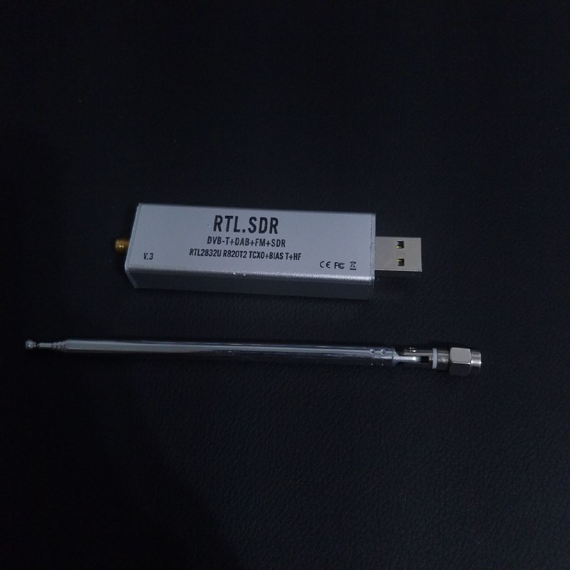
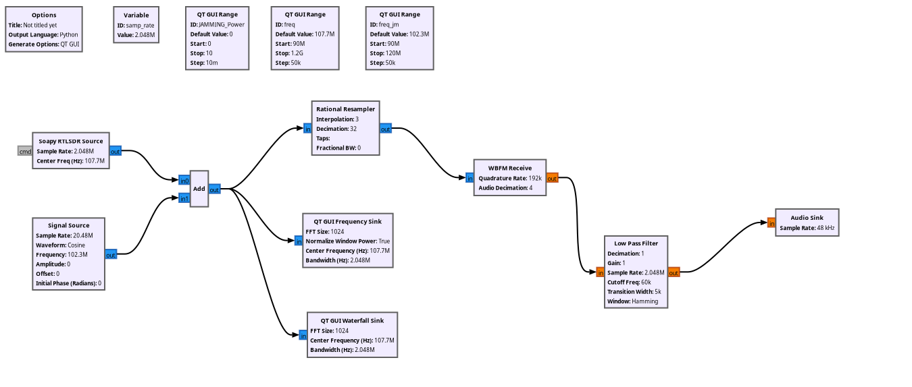
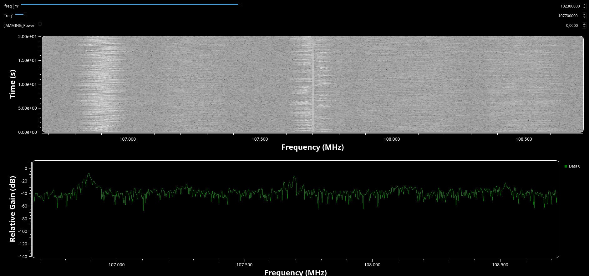
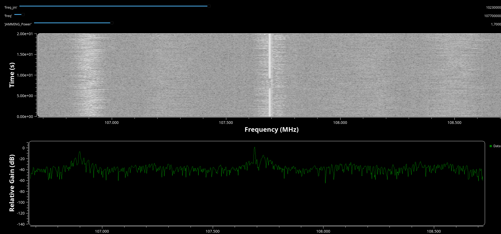
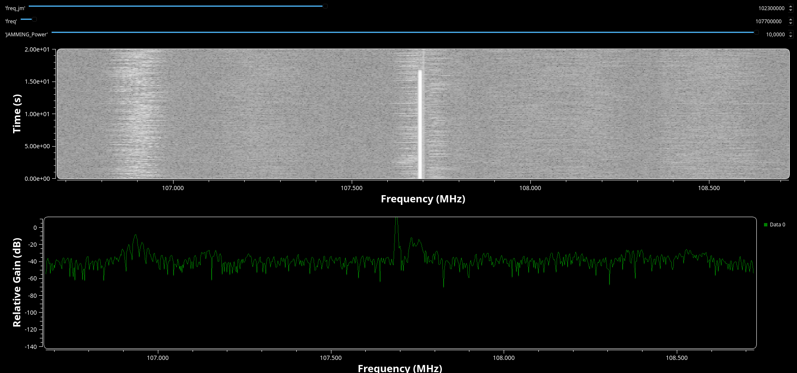

A while ago I attended a mini-course on GNU Radio, and one of the labs was building a jammer. Before anyone calls Anatel on me: nothing was transmitted. The idea is to receive a real FM broadcast station with an RTL-SDR and then add the interference digitally, inside the flowgraph, so you can see and hear what jamming does to a signal without disturbing anyone else's spectrum. Today I am going to explain the telecommunications concepts behind it, walk through every block of the flowgraph, show how I got the RTL-SDR working on Linux (which was honestly half the battle), and present the results. And, as in my [Yagi-Uda post](/posts/how-to-not-design-a-yagi-uda-antenna/), I will also point out two things in the flowgraph that do not do exactly what they appear to do.

> Transmitting signals with the intent of interfering with radio communications is illegal in Brazil (Anatel), in the United States (FCC, 47 U.S.C. §333) and in practically every other country. Everything in this post happens in software: the RTL-SDR is a receive-only device, and the interference only exists as numbers added to the received samples.
{: .prompt-danger }

---

## Theoretical Background

### What Is a Jammer?

A jammer is a device that deliberately emits radio signals on the same frequencies used by a communication system, with the goal of preventing receivers from correctly recovering the desired signal. It does not need to decode or understand the target signal: it just has to put enough unwanted energy in the right place of the spectrum so that, at the receiver, the interference becomes stronger than the information.

Jammers are used in military electronic warfare and, in some countries, in strictly authorized situations such as prisons. For everyone else, operating one is a crime, precisely because interference does not choose its victims: the same signal that blocks the intended target can also take down emergency communications, aviation and navigation systems nearby.

---

### Software Defined Radio

A Software Defined Radio (SDR) is a radio system in which components that were traditionally implemented in hardware (mixers, filters, demodulators) are implemented in software. The hardware is reduced to the minimum: an antenna, a tuner that shifts the desired frequency band down, and an analog-to-digital converter (ADC). Everything after the ADC is just math running on a computer.

The RTL-SDR used in this project is a cheap USB dongle originally designed for digital TV reception, built around the Realtek RTL2832U chip. Mine uses the Fitipower FC0013 tuner, which is older and less common than the popular R820T, but covers the FM broadcast band without problems.


_RTL-SDR dongle used in this project._

---

### IQ Sampling and Complex Baseband

The RTL-SDR does not deliver the radio signal as it exists in the air. It tunes to a center frequency $f_c$, shifts the band around it down to 0 Hz and delivers it as a stream of complex samples:

$$
x[n] = I[n] + jQ[n]
$$

where:
- $I[n]$ is the in-phase component
- $Q[n]$ is the quadrature component (the same signal shifted by 90°)

This representation is called complex baseband. Because the samples are complex, positive and negative frequencies are distinguishable, so a sample rate $f_s$ covers a total bandwidth of $f_s$ centered on $f_c$:

$$
f_c - \frac{f_s}{2} \;\le\; f \;\le\; f_c + \frac{f_s}{2}
$$

With $f_c = 107.7$ MHz and $f_s = 2.048$ MS/s, the flowgraph "sees" everything from 106.676 MHz to 108.724 MHz. A station at exactly $f_c$ appears at 0 Hz in the samples, and a signal 10 kHz below the center appears at −10 kHz.

---

### Nyquist and Aliasing

The Nyquist theorem states that, to represent a real signal without ambiguity, the sampling frequency must be at least twice its highest frequency component:

$$
f_s \geq 2B
$$

For complex samples, the unambiguous range is $[-f_s/2,\, f_s/2]$. Any frequency outside this range does not disappear: it "folds" back into it. This phenomenon is called aliasing.

A familiar example is the wagon-wheel effect in movies: a camera records a fixed number of frames per second, so a wheel spinning fast enough can look like it is turning slowly, standing still, or even spinning backwards. The camera is sampling the wheel too slowly, and the real rotation is misinterpreted as a different one. Sampled signals suffer from the same ambiguity: once a high frequency is sampled too slowly, it becomes indistinguishable from a lower one. The apparent frequency is:

$$
f_{alias} = f - k \cdot f_s
$$

where $k$ is the integer that brings $f_{alias}$ into $[-f_s/2,\, f_s/2]$.

Keep this equation in mind, because it explains one of the blocks of the flowgraph in a way that is not obvious at first.

---

### Frequency Modulation

Commercial FM broadcast, between 88 and 108 MHz, uses frequency modulation: the information (audio) changes the instantaneous frequency of the carrier, while the amplitude stays constant:

$$
s(t) = A_c \cos\left(2\pi f_c t + 2\pi k_f \int_0^t m(\tau)\,d\tau\right)
$$

where:
- $A_c$ is the carrier amplitude
- $f_c$ is the carrier frequency
- $k_f$ is the frequency sensitivity of the modulator (Hz per unit of amplitude)
- $m(t)$ is the message signal (audio)

Broadcast FM uses a maximum frequency deviation of $\Delta f = 75$ kHz and audio up to $f_m = 15$ kHz. The occupied bandwidth can be estimated by Carson's rule:

$$
B_{FM} \approx 2(\Delta f + f_m) = 2(75 + 15) = 180\,\text{kHz}
$$

Adding the stereo pilot and subcarriers, broadcast channels are spaced 200 kHz apart. This is why this mode is called Wideband FM (WBFM), as opposed to the narrowband FM used in handheld radios.

At the transmitter, high audio frequencies are boosted (pre-emphasis) before modulation, and the receiver attenuates them back (de-emphasis). This improves the SNR, since FM noise grows with frequency. Brazil, like the rest of the Americas, uses a time constant of 75 µs.

---

### SNR and Jamming-to-Signal Ratio

The signal-to-noise ratio (SNR) compares the power of the desired signal with the power of the noise:

$$
SNR\,(dB) = 10\log\frac{P_S}{P_N}
$$

Jamming works by degrading this ratio on purpose: instead of waiting for noise to degrade the signal, an interfering signal is added. The relevant metric then becomes the Jamming-to-Signal ratio (J/S):

$$
J/S\,(dB) = 10\log\frac{P_J}{P_S} = 20\log\frac{A_J}{A_S}
$$

where $P_J$ and $A_J$ are the power and amplitude of the jamming signal, and $P_S$ and $A_S$ are those of the desired signal. The second form matters here, because the slider in the flowgraph controls amplitude, not power: doubling it increases the jamming power by 6 dB, not 3 dB.

---

### Types of Jamming

At a conceptual level, jamming techniques are usually classified by how the interference occupies the spectrum:

- **Spot (tone) jamming:** a single carrier or narrowband signal concentrated on the target frequency. All the energy goes to one place.
- **Barrage jamming:** noise spread over a wide band, covering several channels at once at the cost of less power per channel.
- **Sweep jamming:** a narrowband signal that moves across a band over time, hitting each channel briefly.

The flowgraph in this post implements the simplest one: a single unmodulated carrier, that is, spot jamming.

---

### FM Capture Effect

FM has a particular behavior when two signals share the same channel: the demodulator tends to "lock" onto the stronger one and suppress the weaker one. This is called the capture effect.

In practice, this defines three regimes as the jammer amplitude increases:

- **J/S well below 0 dB:** the station dominates, and the carrier only adds a weak interference tone to the audio.
- **J/S near 0 dB:** neither signal dominates, and the audio becomes heavily distorted.
- **J/S above 0 dB:** the demodulator is captured by the carrier. Since it is unmodulated, it carries no audio, and the station practically disappears.

This explains why jamming FM is not a gradual fade: there is a fairly abrupt transition when the interference becomes stronger than the signal.

---

## The Flowgraph

The complete flowgraph is shown below. The signal path is simple: the RTL-SDR receives the FM station, a Signal Source generates the jamming carrier, and an Add block sums both. The result goes to two visualization sinks (spectrum and waterfall) and, in parallel, to a demodulation chain that ends at the computer speakers.


_Complete GNU Radio Companion flowgraph of the simulated jammer._

Each block is explained below, following the order in which the signal flows.

---

### Options

The Options block defines the properties of the flowgraph itself. Here, the most important setting is **Generate Options: QT GUI**, which makes GNU Radio generate a Python script with a graphical window, needed for the sliders and plots. The **Output Language** is Python, so the flowgraph is converted into a `.py` file that can also be run without GNU Radio Companion.

---

### Variable (samp_rate)

The `samp_rate` variable sets the sample rate to 2.048 MS/s, shared by several blocks. This value was not chosen randomly: it is one of the rates at which the RTL-SDR works stably, it covers a 2 MHz window (enough to see the station and its neighbors), and it divides nicely down to the rates the demodulator needs, as shown in the Rational Resampler section.

---

### QT GUI Range (sliders)

The three QT GUI Range blocks create the sliders in the graphical interface, allowing parameters to be changed while the flowgraph is running:

| ID | Default | Range | Step | What it controls |
|---|---|---|---|---|
| `freq` | 107.7 MHz | 90 MHz – 1.2 GHz | 50 kHz | Center frequency of the RTL-SDR |
| `freq_jm` | 102.3 MHz | 90 – 120 MHz | 50 kHz | Frequency parameter of the jamming carrier |
| `JAMMING_Power` | 0 | 0 – 10 | 0.01 | Amplitude of the jamming carrier |

_Table 1: Sliders defined in the flowgraph._

The default value of `freq` is 107.7 MHz because there is a local FM station operating on this frequency in my region, so it guarantees a strong, clean signal to be jammed. If you replicate this experiment, change it to a station that is strong where you live. The range of 90 MHz to 1.2 GHz covers the FM band and goes well beyond it, in case you want to explore other signals.

The default value of `freq_jm`, 102.3 MHz, came from the mini-course flowgraph. As the [Closer Look](#a-closer-look-two-blocks-that-dont-do-what-they-seem) section shows, this value combined with the Signal Source sample rate is what places the carrier inside the 107.7 MHz channel, even though 102.3 MHz is nowhere near it.

`JAMMING_Power` starts at 0 so that the flowgraph opens with the jammer off, and the station can be heard clean before any interference is added. Despite the name, it controls amplitude, not power, as explained in the SNR section.

---

### Soapy RTLSDR Source

This block is the interface with the hardware. It uses SoapySDR, a vendor-neutral abstraction library that allows the same flowgraph to talk to different SDRs through plug-in modules. It is configured with:

- **Sample Rate:** 2.048 MS/s (`samp_rate`)
- **Center Freq:** 107.7 MHz (`freq`), the frequency of a local FM station
- **Gain:** 20 dB, manual mode (AGC disabled)

The output is a stream of complex float samples (`fc32`) normalized between −1 and 1, representing the 2.048 MHz window around 107.7 MHz. The FC0013 tuner supports a maximum gain of 19.7 dB, so the driver simply uses the closest supported value. The gray `cmd` port on the left is a message port that allows sending commands (such as retuning) to the block at runtime. It is not used here.

An important detail: the RTL-SDR is the only block with a real clock. It delivers exactly 2.048 million samples per second, and this pace propagates through the entire flowgraph.

---

### Signal Source

The Signal Source generates the jamming signal: a complex cosine wave whose amplitude is controlled by `JAMMING_Power`. With amplitude 0, the jammer is off. In the configured state:

- **Waveform:** Cosine
- **Frequency:** 102.3 MHz (`freq_jm`)
- **Sample Rate:** 20.48 MS/s (`10*samp_rate`)
- **Amplitude:** `JAMMING_Power`

For a complex output, the block generates:

$$
j[n] = A_J \, e^{\,j\Delta\phi\, n}, \quad \Delta\phi = 2\pi\frac{f}{f_{s,block}}
$$

where $A_J$ is the amplitude and $\Delta\phi$ is the phase increment between consecutive samples. Notice that the frequency and sample rate parameters are only used to compute $\Delta\phi$. The block does not have a clock of its own: it produces samples as fast as the next block consumes them, which, in this case, is the pace imposed by the RTL-SDR. How this combination ends up placing the carrier inside the FM channel is covered in the [Closer Look](#a-closer-look-two-blocks-that-dont-do-what-they-seem) section.

---

### Add

The Add block sums the two complex streams sample by sample:

$$
y[n] = x[n] + j[n]
$$

where $x[n]$ is the received signal and $j[n]$ is the jamming carrier. This single block is the whole "channel" of the simulation. In a real jamming scenario, the sum would happen in the air, at the receiver's antenna. Here, it happens after the ADC, so there is no saturation of the RTL-SDR front end: since the samples are floats, the digital sum can exceed 1 without clipping. This is a difference from the real world worth keeping in mind, where a strong interferer would also saturate the receiver's amplifiers and ADC.

From here, the output of the Add block goes to three places at once: the two visualization sinks and the demodulation chain.

---

### QT GUI Frequency Sink

The Frequency Sink computes the FFT of the signal and plots the spectrum in real time. With an FFT size of $N = 1024$ points, the frequency resolution is:

$$
\Delta f = \frac{f_s}{N} = \frac{2.048 \times 10^6}{1024} = 2\,\text{kHz}
$$

which means each point of the plot represents a 2 kHz slice of the spectrum. A Blackman-Harris window is applied before the FFT to reduce spectral leakage, and the vertical axis goes from −140 to 10 dB (relative, not absolute power). In this plot, the FM station appears as a wide hump roughly 200 kHz across, and the jamming carrier appears as a narrow spike.

---

### QT GUI Waterfall Sink

The Waterfall Sink shows the same spectrum, but over time: the horizontal axis is frequency, the vertical axis is time, and the color represents intensity. It is especially useful for seeing what changes. When the slider is moved, the jammer appears as a vertical line that becomes brighter as the amplitude increases.

---

### Rational Resampler

The demodulator expects a lower sample rate than the RTL-SDR provides. The Rational Resampler changes the sample rate by a ratio of two integers: it interpolates by $L$ and decimates by $M$, applying an anti-aliasing low-pass filter in between:

$$
f_{out} = f_{in} \cdot \frac{L}{M} = 2.048 \times 10^6 \cdot \frac{3}{32} = 192\,\text{kS/s}
$$

192 kS/s is enough to hold the full FM channel (about ±100 kHz) and is exactly 4 × 48 kHz, which makes the final conversion to audio simple. Leaving the Taps field empty makes GNU Radio design the filter automatically.

---

### WBFM Receive

The WBFM Receive block is the FM demodulator. Internally, it does three things:

1. **Quadrature demodulation:** computes the phase difference between consecutive samples. Since frequency is the derivative of phase, this difference is proportional to the instantaneous frequency, that is, to the original audio $m(t)$.
2. **De-emphasis:** attenuates the high audio frequencies that were boosted at the transmitter (75 µs).
3. **Decimation:** with **Audio Decimation = 4**, reduces the rate from 192 kS/s (the **Quadrature Rate**) to 48 kS/s, the audio rate.

Notice that the output port changes from blue to orange: from this point on, the samples are real floats (audio), no longer complex.

---

### Low Pass Filter

The Low Pass Filter is meant to clean up the audio, removing anything above the audible band before it reaches the speakers. It is configured with a cutoff of 60 kHz, a transition width of 5 kHz and a Hamming window. As with the Signal Source, there is a subtlety in its configuration, covered in the [Closer Look](#a-closer-look-two-blocks-that-dont-do-what-they-seem) section.

---

### Audio Sink

Finally, the Audio Sink sends the samples to the computer's sound card at 48 kHz. This is where you hear the result: the radio station, and what happens to it as the jammer gets stronger.

---

## Setting Up the RTL-SDR

Before testing, the flowgraph has to actually find the RTL-SDR. On my first attempt, it did not:

```text
RuntimeError: SoapySDR::Device::make() no match
```

This error means that SoapySDR could not find any device matching `driver=rtlsdr`. Below is the troubleshooting process, which may save you some time. My system runs Arch Linux, but the commands for other distributions are included as well.

### Step 1: check that the hardware works

The `rtl_test` tool (from the `rtl-sdr` package) talks to the dongle directly, without SoapySDR:

```console
$ rtl_test
Found 1 device(s):
  0:  Realtek, RTL2838UHIDIR, SN: 00000001

Using device 0: Generic RTL2832U OEM
Found Fitipower FC0013 tuner
Supported gain values (23): -9.9 -7.3 -6.5 -6.3 -6.0 -5.8 -5.4 5.8 6.1 6.3 6.5 6.7 6.8 7.0 7.1 17.9 18.1 18.2 18.4 18.6 18.8 19.1 19.7
Sampling at 2048000 S/s.
Reading samples in async mode...
```

If the device is found and samples are being read, the hardware, the USB connection and the permissions are fine. Stop it with **Ctrl+C** before moving on.

> Only one program can use the RTL-SDR at a time. If `rtl_test`, GQRX or any other SDR software is running, GNU Radio will not be able to open the device.
{: .prompt-warning }

If `rtl_test` complains that the device is being used by the kernel, the digital TV driver claimed the dongle. Blacklist it and replug the device:

```bash
echo 'blacklist dvb_usb_rtl28xxu' | sudo tee /etc/modprobe.d/blacklist-rtl.conf
```

If it only works with `sudo`, the udev rules from the `rtl-sdr` package are missing.

### Step 2: check SoapySDR modules

Since the hardware worked, the problem was in SoapySDR. The `--info` option lists the installed modules:

```console
$ SoapySDRUtil --info
Lib Version: v0.8.1-ARCH
API Version: v0.8.0
ABI Version: v0.8
Install root: /usr
Search path:  /usr/lib/SoapySDR/modules0.8       (missing)
Search path:  /usr/local/lib/SoapySDR/modules0.8 (missing)
No modules found!
Available factories... No factories found!
```

There it is: **No modules found!** SoapySDR itself was installed (GNU Radio depends on it), but not the module that teaches it how to talk to an RTL-SDR.

### Step 3: install the RTL-SDR module

```bash
# Arch Linux
sudo pacman -S soapyrtlsdr

# Debian / Ubuntu / Mint
sudo apt install soapysdr-module-rtlsdr

# Fedora
sudo dnf install soapy-rtlsdr
```

Running `--info` again, the module now shows up and `rtlsdr` appears as an available factory:

```console
$ SoapySDRUtil --info
Search path:  /usr/lib/SoapySDR/modules0.8
Module found: /usr/lib/SoapySDR/modules0.8/librtlsdrSupport.so (0.3.3)
Available factories... rtlsdr
```

### Step 4: confirm the device is found

```console
$ SoapySDRUtil --find
Found Fitipower FC0013 tuner
Found device 0
  driver = rtlsdr
  label = Generic RTL2832U OEM :: 00000001
  manufacturer = Realtek
  product = RTL2838UHIDIR
  serial = 00000001
  tuner = Fitipower FC0013
```

The `driver = rtlsdr` line is exactly what the Soapy RTLSDR Source block looks for. After this, the flowgraph runs normally.

> If the module is installed but the device is still not found, there may be a version mismatch between SoapySDR installations (for example, one from the package manager and another from conda or a manual build). A practical workaround is replacing the Soapy block with the **osmocom Source** block (`gr-osmosdr`) using the device argument `rtl=0`.
{: .prompt-tip }

---

## Testing

With the flowgraph running, the local station at 107.7 MHz is received and played through the speakers. If you are replicating this and there is no strong station at this frequency in your region, adjust the `freq` slider to a local one. Since the spectrum shows a 2 MHz window, neighboring stations appear as humps, which helps finding them.

The test consisted of increasing `JAMMING_Power` gradually and observing the spectrum, the waterfall and the audio.

### No jamming (JAMMING_Power = 0)

<!-- Frequency Sink + Waterfall with JAMMING_Power = 0 -->

_Spectrum and waterfall with the jammer off: only the FM station is visible._

With the jammer off, the spectrum shows only the FM station: a hump about 200 kHz wide centered on 107.7 MHz, over the receiver's noise floor. 

### Weak jamming

<!-- same view with an intermediate value (note the value used in the caption) -->

_Spectrum and waterfall with JAMMING_Power = 1.7000: the carrier appears inside the FM channel._

As the amplitude increases, a narrow spike appears inside the station's channel, slightly below the center. In the waterfall, it shows up as a thin vertical line.

### Strong jamming

<!-- IMAGE: same view with a high value -->

_Spectrum and waterfall with JAMMING_Power = 10.0000: the carrier dominates the channel._

When the carrier becomes stronger than the station, the capture effect takes over: the demodulator locks onto the unmodulated carrier, and the station's audio 

---

## A Closer Look: Two Blocks That Don't Do What They Seem

While writing this post I went back through every parameter, and two blocks caught my attention. Neither breaks the experiment, but both work differently from what their labels suggest, and understanding why turned out to be a good exercise in sampling theory.

### The jammer is not at 102.3 MHz

The Signal Source is configured with a frequency of 102.3 MHz and a sample rate of 20.48 MS/s. But 102.3 MHz is not even inside the 2 MHz window the RTL-SDR is looking at. So why does the carrier show up inside the station's channel?

The answer is aliasing. The block computes its phase increment from the configured values:

$$
\frac{f}{f_{s,block}} = \frac{102.3 \times 10^6}{20.48 \times 10^6} = 4.9951\,\text{cycles/sample}
$$

Since phase wraps every $2\pi$, whole cycles are invisible: 4.9951 cycles per sample is indistinguishable from $4.9951 - 5 = -0.00488$ cycles per sample. And since the samples actually flow at the pace of the RTL-SDR (2.048 MS/s, not 20.48 MS/s), the real frequency of the carrier relative to the center is:

$$
f_{offset} = -0.00488 \cdot 2.048 \times 10^6 \approx -10\,\text{kHz}
$$

In other words, the carrier lands at 107.69 MHz, 10 kHz below the station's center, right inside the channel. Some side effects of this: each 50 kHz step of the `freq_jm` slider moves the carrier by only 5 kHz, setting it to 102.4 MHz places the carrier exactly at the center, and every 20.48 MHz of slider travel sweeps the carrier across the whole window once.

A cleaner configuration, where the slider means exactly what it says, is to run the Signal Source at the real sample rate and use the offset relative to the tuned frequency:

| Parameter | Original | Suggested |
|---|---|---|
| Sample Rate | `10*samp_rate` | `samp_rate` |
| Frequency | `freq_jm` | `freq_jm - freq` |

_Table 2: Suggested Signal Source configuration._

With this, `freq_jm` becomes the actual RF frequency of the jammer, as long as it stays within the visible window, that is, $|f_{jm} - f_c| < f_s/2 = 1.024$ MHz.

### The Low Pass Filter is designed for the wrong sample rate

The Low Pass Filter sits after the WBFM Receive block, where the signal is audio at 48 kS/s. However, it is designed with a sample rate of 2.048 MS/s. GNU Radio designs filters in terms of normalized frequency (cutoff divided by sample rate), so the cutoff the filter actually applies is:

$$
f_{c,real} = 60\,\text{kHz} \cdot \frac{48 \times 10^3}{2.048 \times 10^6} \approx 1.4\,\text{kHz}
$$

A 1.4 kHz cutoff removes most of the audio band, leaving the sound muffled. As a bonus, the narrow transition width (5 kHz relative to 2.048 MS/s) generates a filter with over a thousand taps, which costs CPU for no reason. Since WBFM Receive already filters the audio internally, the simplest fix is removing the block. Alternatively, setting it to a sample rate of 48 kHz, a cutoff of 15 kHz and a transition width of 2 kHz makes it behave as intended.

---

## Conclusion and Next Steps

This lab turned out to be a compact way of visualizing several telecommunications concepts at once: complex baseband sampling, FM demodulation, SNR and J/S ratio, the capture effect and even aliasing, which appeared where I least expected it. And since the interference is added digitally, it is possible to explore all of this with a receive-only device, without transmitting anything.

Some ideas for future iterations:

- **Other jamming types:** replacing the Signal Source with a Noise Source to simulate barrage jamming, and comparing how much power each type needs to degrade the station.
- **Other signals:** recording a Flipper Zero transmission at 433.92 MHz with the RTL-SDR, then feeding the recorded IQ file into the flowgraph and applying the simulated interference to it. Since those signals use OOK instead of FM, the demodulation chain would need to change.
- **Measuring the transition:** quantifying the J/S ratio at which the capture effect happens, instead of only observing it.

Repository: [Source Code](https://github.com/GetulioVictor/gnu-radio-simulated-jammer)

---

## References

GNU Radio Project, "GNU Radio Documentation", GNU Radio Wiki. Available at: [https://wiki.gnuradio.org/](https://wiki.gnuradio.org/).

Pothosware, "SoapySDR -- Vendor and platform neutral SDR support library", GitHub. Available at: [https://github.com/pothosware/SoapySDR](https://github.com/pothosware/SoapySDR).

Pothosware, "SoapyRTLSDR -- SoapySDR RTL-SDR Support Module", GitHub. Available at: [https://github.com/pothosware/SoapyRTLSDR](https://github.com/pothosware/SoapyRTLSDR).

Haykin, S., Communication Systems, 4th ed. New York: Wiley, 2001.
